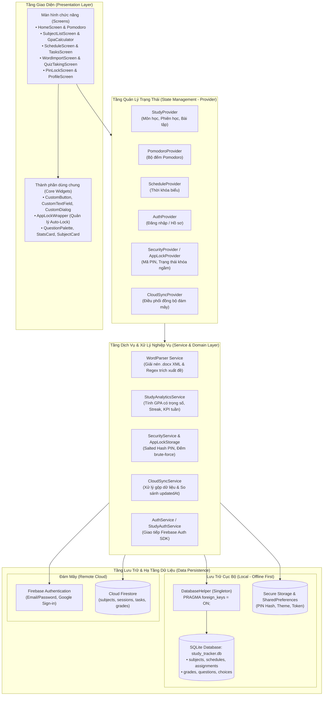
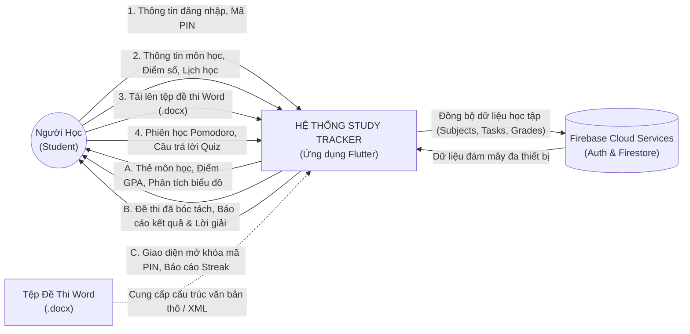
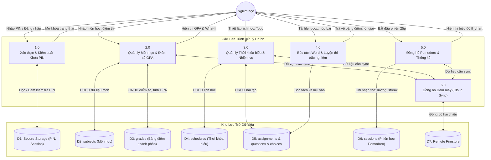
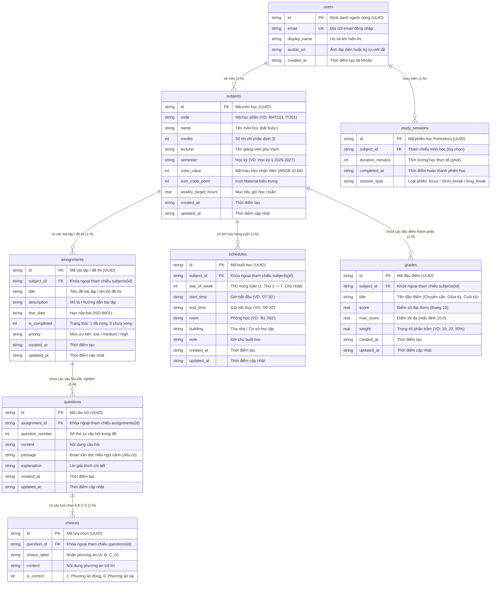

# BÁO CÁO BÀI TẬP LỚN / DỰ ÁN HỆ THỐNG
# HỆ THỐNG QUẢN LÝ HỌC TẬP, LUYỆN THI & BẢO MẬT CÁ NHÂN - STUDY TRACKER

---

## MỤC LỤC
- [Phần 2: Phân tích và Thiết kế hệ thống (Analysis & Design)](#phần-2-phân-tích-và-thiết-kế-hệ-thống-analysis--design)
  - [2.1. Yêu cầu hệ thống](#21-yêu-cầu-hệ-thống)
    - [2.1.1. Yêu cầu chức năng (Functional Requirements)](#211-yêu-cầu-chức-năng-functional-requirements)
    - [2.1.2. Yêu cầu phi chức năng (Non-Functional Requirements)](#212-yêu-cầu-phi-chức-năng-non-functional-requirements)
  - [2.2. Sơ đồ kiến trúc và Mô hình dữ liệu](#22-sơ-đồ-kiến-trúc-và-mô-hình-dữ-liệu)
    - [2.2.1. Sơ đồ kiến trúc tổng thể hệ thống (System Architecture)](#221-sơ-đồ-kiến-trúc-tổng-thể-hệ-thống-system-architecture)
    - [2.2.2. Sơ đồ luồng dữ liệu (Data Flow Diagram - DFD)](#222-sơ-đồ-luồng-dữ-liệu-data-flow-diagram---dfd)
    - [2.2.3. Sơ đồ quan hệ thực thể (Entity Relationship Diagram - ERD)](#223-sơ-đồ-quan-hệ-thực-thể-entity-relationship-diagram---erd)
    - [2.2.4. Phân tích chuẩn hóa cơ sở dữ liệu (Database Normalization - 1NF, 2NF, 3NF/BCNF)](#224-phân-tích-chuẩn-hóa-cơ-sở-dữ-liệu-database-normalization---1nf-2nf-3nfbcnf)
    - [2.2.5. Từ điển dữ liệu chi tiết (Data Dictionary)](#225-từ-điển-dữ-liệu-chi-tiết-data-dictionary)
  - [2.3. Giao diện mẫu (Mockups / Wireframes)](#23-giao-diện-mẫu-mockups--wireframes)
    - [2.3.1. Hệ thống thiết kế (Design System & Color Tokens)](#231-hệ-thống-thiết-kế-design-system--color-tokens)
    - [2.3.2. Bản phác thảo giao diện Người học (Mobile / Desktop Client)](#232-bản-phác-thảo-giao-diện-người-học-mobile--desktop-client)
- [Phần 3: Hiện thực hóa / Triển khai (Implementation)](#phần-3-hiện-thực-hóa--triển-khai-implementation)
  - [3.1. Công nghệ sử dụng](#31-công-nghệ-sử-dụng)
  - [3.2. Cấu trúc mã nguồn dự án](#32-cấu-trúc-mã-nguồn-dự-án)
  - [3.3. Các tính năng cốt lõi và Hiện thực hóa mã nguồn](#33-các-tính-năng-cốt-lõi-và-hiện-thực-hóa-mã-nguồn)
    - [3.3.1. Bộ bóc tách đề thi Word tự động (Word Exam Parser Engine)](#331-bộ-bóc-tách-đề-thi-word-tự-động-word-exam-parser-engine)
    - [3.3.2. Động cơ làm bài thi & Quản lý trạng thái trắc nghiệm (Quiz Engine)](#332-động-cơ-làm-bài-thi--quản-lý-trạng-thái-trắc-nghiệm-quiz-engine)
    - [3.3.3. Tầng lưu trữ SQLite FFI / WASM và Ràng buộc khóa ngoại Cascade](#333-tầng-lưu-trữ-sqlite-ffi--wasm-và-ràng-buộc-khóa-ngoại-cascade)
    - [3.3.4. Cơ chế bảo mật đa tầng: Mã hóa Salted Hash & Background Auto-Lock](#334-cơ-chế-bảo-mật-đa-tầng-mã-hóa-salted-hash--background-auto-lock)
    - [3.3.5. Bộ mô phỏng GPA và Tính toán điểm trung bình học kỳ (What-If GPA Simulator)](#335-bộ-mô-phỏng-gpa-và-tính-toán-điểm-trung-bình-học-kỳ-what-if-gpa-simulator)
- [Phần 4: Kiểm thử và Đánh giá (Testing & Evaluation)](#phần-4-kiểm-thử-và-đánh-giá-testing--evaluation)
  - [4.1. Kịch bản kiểm thử (Test Cases)](#41-kịch-bản-kiểm-thử-test-cases)
  - [4.2. Kết quả đạt được](#42-kết-quả-đạt-được)
    - [4.2.1. Đánh giá mức độ hoàn thành so với mục tiêu](#421-đánh-giá-mức-độ-hoàn-thành-so-với-mục-tiêu)
    - [4.2.2. Điểm mạnh của hệ thống](#422-điểm-mạnh-của-hệ-thống)
    - [4.2.3. Hạn chế còn tồn đọng](#423-hạn-chế-còn-tồn-đọng)
- [Phần 5: Tổng kết và Hướng phát triển (Conclusion & Future Work)](#phần-5-tổng-kết-và-hướng-phát-triển-conclusion--future-work)
  - [5.1. Kết luận](#51-kết-luận)
  - [5.2. Bài học kinh nghiệm thu nhận](#52-bài-học-kinh-nghiệm-thu-nhận)
  - [5.3. Hướng phát triển trong tương lai](#53-hướng-phát-triển-trong-tương-lai)
- [Tài liệu tham khảo & Phụ lục](#tài-liệu-tham-khảo--phụ-lục)
  - [Tài liệu tham khảo](#tài-liệu-tham-khảo)
  - [Phụ lục A: Hướng dẫn cài đặt và khởi chạy hệ thống](#phụ-lục-a-hướng-dẫn-cài-đặt-và-khởi-chạy-hệ-thống)
  - [Phụ lục B: Quy tắc bảo mật Firestore Rules](#phụ-lục-b-quy-tắc-bảo-mật-firestore-rules)

---

# Phần 2: Phân tích và Thiết kế hệ thống (Analysis & Design)

## 2.1. Yêu cầu hệ thống

Hệ thống **Study Tracker** được định vị là một giải pháp chuyển đổi số toàn diện cho người học cá nhân (học sinh, sinh viên, người ôn thi chứng chỉ). Hệ thống kết hợp giữa quản lý học vụ chặt chẽ (môn học, tín chỉ, GPA, thời khóa biểu) với các công cụ tạo động lực & kỷ luật học tập (đồng hồ Pomodoro, theo dõi Study Streak), đồng thời tích hợp phân hệ luyện thi thông minh (Quiz Engine bóc tách tự động từ file Word `.docx`) và cơ chế bảo mật khóa ứng dụng bằng mã PIN an toàn.

### 2.1.1. Yêu cầu chức năng (Functional Requirements)

Hệ thống phục vụ người học với các phân hệ chức năng chi tiết sau:

| Mã Yêu Cầu | Phân Hệ Nghiệp Vụ | Tên Chức Năng | Mô Tả Chi Tiết Chức Năng |
| :--- | :--- | :--- | :--- |
| **FR-01** | **Xác thực (Auth)** | Đăng ký & Đăng nhập | Cho phép người dùng tạo tài khoản mới bằng Email/Mật khẩu hoặc sử dụng tính năng "Dùng thử tài khoản Demo" để trải nghiệm ngay. Hỗ trợ xác minh email và reset mật khẩu qua Firebase. |
| **FR-02** | **Quản lý Môn học** | Quản lý Môn học & Tín chỉ | Thêm, sửa, xóa, tìm kiếm môn học; phân loại theo học kỳ; gán mã môn, số tín chỉ, giảng viên, màu sắc nhận diện, icon và mục tiêu giờ học hàng tuần (`weekly_target_hours`). |
| **FR-03** | **Quản lý Điểm số** | Bảng điểm & Tính toán GPA | Quản lý danh mục các đầu điểm thành phần (chuyên cần, giữa kỳ, đồ án, thi kết thúc môn) với trọng số tương ứng (%). Tự động tính điểm trung bình môn hệ 10, hệ 4 và xếp loại chữ (A+, A, B+, B, C, D, F). |
| **FR-04** | **Mô phỏng GPA** | What-If GPA Simulator | Cho phép người học kéo thả thanh trượt (slider) giả định điểm số các môn đang học để tính toán sự thay đổi $\Delta$ GPA học kỳ ngay lập tức, hỗ trợ lưu điểm dự kiến làm điểm chính thức. |
| **FR-05** | **Thời khóa biểu** | Lịch học tuần thông minh | Quản lý lịch học từ Thứ 2 đến Chủ nhật, cấu hình ca học (giờ bắt đầu/kết thúc), phòng học, tòa nhà và ghi chú. Cảnh báo và xử lý ràng buộc Cascade khi xóa môn học. |
| **FR-06** | **Nhiệm vụ & Bài tập** | Quản lý Bài tập (Assignments) | Lập danh sách việc cần làm (Todo list/Assignments) theo từng môn, gắn hạn chót (Deadline), mức độ ưu tiên (Low, Medium, High), trạng thái hoàn thành. |
| **FR-07** | **Luyện thi (Quiz Engine)**| Import đề thi Word (`.docx`) | Bộ giải nén và phân tích cấu trúc tài liệu Word tự động bóc tách đề thi trắc nghiệm: trích xuất câu hỏi, đoạn văn đọc hiểu (Passage), các lựa chọn A/B/C/D, đáp án đúng và lời giải thích. |
| **FR-08** | **Luyện thi (Quiz Engine)**| Phòng thi trắc nghiệm tương tác | Giao diện làm bài thi trực quan với bộ đếm thời gian (Elapsed Timer), dải số câu hỏi (Question Palette) nhảy nhanh đến câu bất kỳ, tự động lưu câu trả lời, cảnh báo câu bỏ sót khi nộp bài. |
| **FR-09** | **Luyện thi (Quiz Engine)**| Báo cáo & Luyện tập câu sai | Hiển thị thẻ kết quả Hero Banner, bảng tổng kết điểm số, bộ lọc xem lại câu sai/đúng, hiển thị hộp lời giải chi tiết. Hỗ trợ 2 chế độ học tập: "Làm lại toàn bộ đề" hoặc "Luyện tập riêng các câu sai". |
| **FR-10** | **Pomodoro & Kỷ luật** | Đồng hồ Pomodoro & Streak | Vận hành phiên tập trung 25 phút, nghỉ ngắn 5 phút, nghỉ dài 15 phút. Ghi nhận thời lượng học thực tế vào cơ sở dữ liệu và duy trì chuỗi ngày học liên tục (Study Streak Days). |
| **FR-11** | **Báo cáo & Thống kê** | Biểu đồ học tập trực quan | Vẽ biểu đồ cột/đường trực quan bằng `fl_chart` thể hiện tổng thời lượng học trong tuần, tỷ lệ đạt mục tiêu từng môn và tiến độ học tập hôm nay. |
| **FR-12** | **Bảo mật (Security)** | Khóa ứng dụng mã PIN | Cấu hình mã PIN 4-6 số với bàn phím Numpad ảo chuyên dụng; mã hóa Salted Hashing chống trích xuất dữ liệu thô. |
| **FR-13** | **Bảo mật (Security)** | Background Auto-Lock | Giám sát trạng thái vòng đời ứng dụng (`WidgetsBindingObserver`), tự động phủ màn hình khóa PIN ngay khi ứng dụng chuyển sang chạy ngầm hoặc mất active. |
| **FR-14** | **Đồng bộ Đám mây** | Offline-First Cloud Sync | Lưu trữ cục bộ toàn diện, tự động đồng bộ hai chiều lên Firebase Cloud Firestore khi có kết nối mạng (kiểm tra `connectivity_plus`), xử lý gộp dữ liệu dựa trên timestamp `updatedAt` và cờ xóa `deletions`. |

---

### 2.1.2. Yêu cầu phi chức năng (Non-Functional Requirements)

1. **Tính sẵn sàng và Khả năng hoạt động Ngoại tuyến (Offline-First Availability):**
   - 100% chức năng cốt lõi (tính điểm GPA, bấm giờ Pomodoro, làm bài thi trắc nghiệm, quản lý thời khóa biểu) phải hoạt động trơn tru không cần kết nối Internet nhờ kiến trúc SQLite cục bộ.
2. **Hiệu năng và Thời gian đáp ứng (Performance & Responsiveness):**
   - Tốc độ tải dữ liệu danh sách môn học, lịch học, câu hỏi trắc nghiệm dưới $100\text{ms}$.
   - Tốc độ bóc tách tệp Word `.docx` 50 câu hỏi kèm đoạn văn ngữ cảnh dưới $1.5\text{s}$ trên thiết bị di động.
   - Giao diện người dùng duy trì tốc độ khung hình ổn định ở mức 60fps (hoặc 120fps trên màn hình tần số quét cao).
3. **An toàn và Bảo mật thông tin (Security & Data Integrity):**
   - **Bảo mật mã PIN:** Tuyệt đối không lưu mã PIN dưới dạng chuỗi thô (plain text). Bắt buộc sử dụng kỹ thuật băm một chiều kèm muối bí mật (Salted Hashing) và lưu trữ trong phân vùng bộ nhớ an toàn (`flutter_secure_storage`).
   - **Chống dò quét Brute-Force:** Tự động khóa tạm ứng dụng 30 giây sau 5 lần nhập sai mã PIN liên tiếp; thời gian tăng dần ở các lần vi phạm tiếp theo (tối đa 15 phút).
   - **Phân quyền Đám mây (Cloud Security Rules):** Toàn bộ dữ liệu trên Firestore được bảo vệ bằng `firestore.rules`, chỉ cho phép người dùng đã xác thực email (`auth.token.email_verified == true`) đọc/ghi dữ liệu có `userId` trùng khớp với `request.auth.uid`.
4. **Toàn vẹn dữ liệu cơ sở dữ liệu (Database Integrity & ACID):**
   - Kích hoạt ràng buộc khóa ngoại nghiêm ngặt `PRAGMA foreign_keys = ON;` trong SQLite.
   - Toàn bộ thao tác xóa môn học hoặc đề thi phải thực thi quy tắc `ON DELETE CASCADE` tự động dọn sạch các bảng phụ thuộc (assignments, questions, choices, schedules, grades), ngăn chặn hiện tượng bản ghi mồ côi (orphaned records).
   - Thao tác nạp bộ câu hỏi trắc nghiệm phải được bao bọc trong một Database Transaction duy nhất để đảm bảo tính nguyên tố (Atomicity).
5. **Khả năng tương thích Đa nền tảng (Cross-Platform Compatibility):**
   - Ứng dụng chạy đồng nhất trên Android, iOS, Windows, Linux, macOS và Web (nhờ cơ chế trừu tượng hóa SQLite FFI và Web Worker WebAssembly WASM).

---

## 2.2. Sơ đồ kiến trúc và Mô hình dữ liệu

### 2.2.1. Sơ đồ kiến trúc tổng thể hệ thống (System Architecture)

Dự án áp dụng mô hình phân lớp kết hợp giữa **Feature-First** và **Core-Shared Layered Architecture**, kết nối với cơ sở dữ liệu SQLite cục bộ và dịch vụ đám mây Firebase.



---

### 2.2.2. Sơ đồ luồng dữ liệu (Data Flow Diagram - DFD)

#### a) Sơ đồ ngữ cảnh (DFD Mức 0 - Context Diagram)



#### b) Sơ đồ luồng dữ liệu phân rã (DFD Mức 1)



---

### 2.2.3. Sơ đồ quan hệ thực thể (Entity Relationship Diagram - ERD)

Toàn bộ cơ sở dữ liệu quan hệ được triển khai trên nền tảng **SQLite** với các ràng buộc toàn vẹn tham chiếu chặt chẽ:



---

### 2.2.4. Phân tích chuẩn hóa cơ sở dữ liệu (Database Normalization - 1NF, 2NF, 3NF/BCNF)

Để đảm bảo hiệu năng truy vấn tối ưu trên thiết bị di động, loại bỏ hoàn toàn các dị thường dữ liệu (dị thường thêm, sửa, xóa) và giảm thiểu trùng lặp, mô hình cơ sở dữ liệu của **Study Tracker** được thiết kế tuân thủ nghiêm ngặt theo các quy tắc chuẩn hóa:

#### 1. Dạng chuẩn 1 (1NF - First Normal Form):
- **Quy tắc:** Mỗi thuộc tính trong bảng phải mang giá trị nguyên tử (Atomic values), không chứa tập giá trị lặp lại hoặc mảng cấu trúc phức tạp.
- **Hiện thực hóa trong hệ thống:**
  - Trong các bài thi trắc nghiệm, một câu hỏi có nhiều phương án trả lời (A, B, C, D) và một bài đọc có thể dùng chung cho nhiều câu hỏi. Thay vì gộp các phương án thành một mảng JSON hoặc chuỗi phân tách bởi dấu phẩy trong bảng `questions`, hệ thống tách riêng bảng `choices`. Mỗi dòng trong `choices` chỉ lưu đúng 1 phương án nguyên tử kèm nhãn `choice_label` và cờ boolean `is_correct`.
  - Tương tự, bảng điểm của môn học không lưu dạng danh sách điểm gộp mà được tách thành từng bản ghi riêng trong bảng `grades`.

#### 2. Dạng chuẩn 2 (2NF - Second Normal Form):
- **Quy tắc:** Đạt 1NF và mọi thuộc tính không khóa đều phải phụ thuộc hàm đầy đủ (Fully functionally dependent) vào khóa chính, không phụ thuộc vào một phần của khóa chính (đối với khóa tổng hợp).
- **Hiện thực hóa trong hệ thống:**
  - Toàn bộ các bảng trong hệ thống (`subjects`, `assignments`, `schedules`, `grades`, `questions`, `choices`) đều sử dụng khóa chính đơn tính chất định danh đại diện (Surrogate Primary Key dạng UUID String `id`).
  - Do khóa chính là khóa đơn (độ dài 1 thuộc tính), nên không thể xảy ra hiện tượng phụ thuộc một phần vào khóa chính $\rightarrow$ **Cơ sở dữ liệu tự động thỏa mãn 2NF**.

#### 3. Dạng chuẩn 3 (3NF - Third Normal Form) & Chuẩn Boyce-Codd (BCNF):
- **Quy tắc:** Đạt 2NF và không có thuộc tính không khóa nào phụ thuộc bắc cầu (Transitive dependency) vào khóa chính (nghĩa là không có phụ thuộc dạng $X \rightarrow Y$ và $Y \rightarrow Z$ với $Z$ là thuộc tính không khóa).
- **Hiện thực hóa trong hệ thống:**
  - **Xét bài toán lưu câu hỏi & lựa chọn:** Nếu lưu `choice_content` và `is_correct` trong bảng `assignments` thì: $\text{assignment\_id} \rightarrow \text{question\_id} \rightarrow \text{choice\_id}$. Để giải quyết, mô hình tách thành 3 bảng với khóa ngoại trực tiếp:
    $$\text{assignments} \xrightarrow{1-N} \text{questions} \xrightarrow{1-N} \text{choices}$$
    Mỗi bảng chỉ chứa các thuộc tính mô tả trực tiếp cho thực thể tương ứng.
  - **Xét bài toán lưu điểm & GPA:** Điểm tổng kết môn, điểm chữ quy đổi (`A+`, `B`...), và điểm trung bình tích lũy GPA là các giá trị phái sinh (Derived values). Hệ thống **không lưu cứng** các giá trị này vào cột của bảng `subjects` nhằm tránh dị thường cập nhật khi người dùng sửa một đầu điểm trong `grades`. Thay vào đó, điểm trung bình môn và GPA học kỳ được tính toán động (dynamically computed) tại tầng nghiệp vụ `StudyAnalyticsService` và hiển thị trên giao diện theo thời gian thực:
    $$\text{Điểm môn} = \frac{\sum (\text{score}_i \times \text{weight}_i)}{\sum \text{weight}_i}$$
    $$\text{GPA} = \frac{\sum (\text{Điểm môn}_j \times \text{credits}_j)}{\sum \text{credits}_j}$$
  - Nhờ việc loại bỏ toàn bộ phụ thuộc bắc cầu và chỉ giữ lại các phụ thuộc vào siêu khóa (Superkey), mô hình hoàn toàn đạt **chuẩn 3NF và BCNF**.

---

### 2.2.5. Từ điển dữ liệu chi tiết (Data Dictionary)

Bảng tổng hợp đặc tả chi tiết cấu trúc các bảng vật lý trong tệp cơ sở dữ liệu `study_tracker.db`:

#### Bảng 1: `subjects` (Quản lý danh mục môn học)
| Tên Cột | Kiểu Dữ Liệu | Ràng Buộc (Constraints) | Mô Tả Ý Nghĩa |
| :--- | :--- | :--- | :--- |
| `id` | `TEXT` | `PRIMARY KEY` | Khóa chính, chuỗi định danh duy nhất (UUID). |
| `code` | `TEXT` | `NULL` | Mã môn học / học phần (VD: `MAT101`, `IT201`). |
| `name` | `TEXT` | `NOT NULL` | Tên đầy đủ của môn học. |
| `credits` | `INTEGER` | `DEFAULT 3` | Số tín chỉ môn học tích lũy. |
| `lecturer` | `TEXT` | `NULL` | Họ tên giảng viên phụ trách môn học. |
| `semester` | `TEXT` | `NULL` | Học kỳ đăng ký (VD: `Học kỳ 1 2026-2027`). |
| `color_value`| `INTEGER` | `NOT NULL` | Mã màu Hex nhận diện (ARGB 32-bit integer). |
| `icon_code_point`| `INTEGER` | `NOT NULL` | Mã Icon trong bộ Material Icons. |
| `weekly_target_hours`| `REAL` | `NOT NULL DEFAULT 5.0`| Số giờ mục tiêu cần tự học mỗi tuần. |
| `created_at` | `TEXT` | `NOT NULL` | Chuỗi thời gian tạo bản ghi (ISO-8601). |
| `updated_at` | `TEXT` | `NOT NULL` | Chuỗi thời gian cập nhật gần nhất (ISO-8601). |

#### Bảng 2: `assignments` (Bài tập, Nhiệm vụ và Bộ đề thi)
| Tên Cột | Kiểu Dữ Liệu | Ràng Buộc (Constraints) | Mô Tả Ý Nghĩa |
| :--- | :--- | :--- | :--- |
| `id` | `TEXT` | `PRIMARY KEY` | Khóa chính, UUID. |
| `subject_id` | `TEXT` | `NOT NULL, FK` | Khóa ngoại tham chiếu `subjects(id)` `ON DELETE CASCADE`. |
| `title` | `TEXT` | `NOT NULL` | Tiêu đề bài tập hoặc tên bộ đề thi trắc nghiệm. |
| `description`| `TEXT` | `NULL` | Mô tả yêu cầu, số câu hỏi, thời gian làm bài. |
| `due_date` | `TEXT` | `NOT NULL` | Hạn chót hoàn thành (ISO-8601). |
| `is_completed`| `INTEGER` | `NOT NULL DEFAULT 0`| Cờ trạng thái: 1 là đã hoàn thành, 0 là đang làm. |
| `priority` | `TEXT` | `DEFAULT 'medium'` | Mức ưu tiên: `low`, `medium`, `high`. |
| `created_at` | `TEXT` | `NOT NULL` | Thời gian tạo bản ghi. |
| `updated_at` | `TEXT` | `NOT NULL` | Thời gian cập nhật gần nhất. |

#### Bảng 3: `schedules` (Lịch học và Thời khóa biểu hàng tuần)
| Tên Cột | Kiểu Dữ Liệu | Ràng Buộc (Constraints) | Mô Tả Ý Nghĩa |
| :--- | :--- | :--- | :--- |
| `id` | `TEXT` | `PRIMARY KEY` | Khóa chính, UUID. |
| `subject_id` | `TEXT` | `NOT NULL, FK` | Khóa ngoại tham chiếu `subjects(id)` `ON DELETE CASCADE`. |
| `day_of_week`| `INTEGER` | `NOT NULL` | Thứ trong tuần: 1 (Thứ 2), 2 (Thứ 3), ..., 7 (Chủ nhật). |
| `start_time` | `TEXT` | `NOT NULL` | Giờ bắt đầu buổi học (Định dạng `HH:mm`, VD: `07:30`). |
| `end_time` | `TEXT` | `NOT NULL` | Giờ kết thúc buổi học (Định dạng `HH:mm`, VD: `09:30`). |
| `room` | `TEXT` | `NOT NULL` | Ký hiệu phòng học (VD: `A2-401`, `Online Zoom`). |
| `building` | `TEXT` | `NULL` | Tòa nhà / cơ sở đào tạo. |
| `note` | `TEXT` | `NULL` | Ghi chú buổi học hoặc đường dẫn tài liệu. |
| `created_at` | `TEXT` | `NOT NULL` | Thời gian tạo bản ghi. |
| `updated_at` | `TEXT` | `NOT NULL` | Thời gian cập nhật gần nhất. |

#### Bảng 4: `grades` (Chi tiết các đầu điểm thành phần môn học)
| Tên Cột | Kiểu Dữ Liệu | Ràng Buộc (Constraints) | Mô Tả Ý Nghĩa |
| :--- | :--- | :--- | :--- |
| `id` | `TEXT` | `PRIMARY KEY` | Khóa chính, UUID. |
| `subject_id` | `TEXT` | `NOT NULL, FK` | Khóa ngoại tham chiếu `subjects(id)` `ON DELETE CASCADE`. |
| `title` | `TEXT` | `NOT NULL` | Tên đầu điểm (Chuyên cần, Bài tập lớn, Thi cuối kỳ). |
| `score` | `REAL` | `NOT NULL` | Điểm số đạt được (Thang điểm 10). |
| `max_score` | `REAL` | `NOT NULL DEFAULT 10.0` | Thang điểm chuẩn cao nhất. |
| `weight` | `REAL` | `NOT NULL DEFAULT 10.0` | Trọng số phần trăm trong tổng kết môn (%). |
| `created_at` | `TEXT` | `NOT NULL` | Thời gian tạo bản ghi. |
| `updated_at` | `TEXT` | `NOT NULL` | Thời gian cập nhật gần nhất. |

#### Bảng 5: `questions` (Câu hỏi trắc nghiệm của bài tập/đề thi)
| Tên Cột | Kiểu Dữ Liệu | Ràng Buộc (Constraints) | Mô Tả Ý Nghĩa |
| :--- | :--- | :--- | :--- |
| `id` | `TEXT` | `PRIMARY KEY` | Khóa chính, UUID. |
| `assignment_id`| `TEXT` | `NOT NULL, FK` | Khóa ngoại tham chiếu `assignments(id)` `ON DELETE CASCADE`. |
| `question_number`| `INTEGER` | `DEFAULT 1` | Thứ tự câu hỏi trong đề thi. |
| `content` | `TEXT` | `NOT NULL` | Nội dung văn bản của câu hỏi. |
| `passage` | `TEXT` | `NULL` | Đoạn văn đọc hiểu hoặc ngữ cảnh tham chiếu. |
| `explanation` | `TEXT` | `NULL` | Lời giải thích cặn kẽ đáp án đúng. |
| `created_at` | `TEXT` | `NOT NULL` | Thời gian tạo bản ghi. |
| `updated_at` | `TEXT` | `NOT NULL` | Thời gian cập nhật gần nhất. |

#### Bảng 6: `choices` (Phương án trả lời của từng câu hỏi)
| Tên Cột | Kiểu Dữ Liệu | Ràng Buộc (Constraints) | Mô Tả Ý Nghĩa |
| :--- | :--- | :--- | :--- |
| `id` | `TEXT` | `PRIMARY KEY` | Khóa chính, UUID. |
| `question_id` | `TEXT` | `NOT NULL, FK` | Khóa ngoại tham chiếu `questions(id)` `ON DELETE CASCADE`. |
| `choice_label` | `TEXT` | `NOT NULL` | Nhãn phương án: `A`, `B`, `C`, `D`. |
| `content` | `TEXT` | `NOT NULL` | Nội dung câu chữ của lựa chọn. |
| `is_correct` | `INTEGER` | `NOT NULL DEFAULT 0`| 1: Là đáp án chuẩn xác; 0: Là phương án gây nhiễu. |

---

## 2.3. Giao diện mẫu (Mockups / Wireframes)

### 2.3.1. Hệ thống thiết kế (Design System & Color Tokens)

Hệ thống thiết kế của **Study Tracker** tuân thủ hướng dẫn Material 3 kết hợp với các nguyên tắc trực quan hiện đại:
- **Tone màu chủ đạo:**
  - `Primary` (`#4F46E5` - Indigo): Biểu trưng cho sự tập trung, tri thức học thuật và tin cậy.
  - `Secondary` (`#0D9488` - Teal): Màu nhấn tươi mới, cân bằng năng lượng.
  - `Success` (`#10B981` - Emerald Green): Biểu thị bài hoàn thành, câu trả lời đúng, điểm cao.
  - `Warning` (`#F59E0B` - Amber): Biểu thị sắp hết giờ thi, phiên nghỉ ngơi Pomodoro, deadline gần.
  - `Error / Danger` (`#EF4444` - Rose Red): Cảnh báo sai mã PIN, câu trả lời sai, xóa môn học.
- **Nền & Bề mặt:**
  - `Light Mode Background`: `#F8FAFC` (Slate 50) mang lại cảm giác sáng sủa, êm dịu cho mắt.
  - `Dark Mode Background`: `#0F172A` (Slate 900) tiết kiệm pin AMOLED và hỗ trợ học đêm.
- **Typography:** Phông chữ hệ thống hiện đại, dễ đọc, cấu hình các cấp bậc từ `displayLarge` (32px, bold), `titleLarge` (20px, w600) đến `bodyMedium` (14px).

---

### 2.3.2. Bản phác thảo giao diện Người học (Mobile / Desktop Client)

#### Wireframe 1: Màn hình chính & Đồng hồ Pomodoro (`HomeScreen`)
```text
+--------------------------------------------------------------+
| [=] Study Tracker                    [🔔] [🌙 Theme] [🔒 PIN] |
+--------------------------------------------------------------+
| 🔥 Chuỗi học tập: 5 ngày liên tục!     ⭐ Điểm GPA HK: 3.65 / 4.0 |
+--------------------------------------------------------------+
|  +--------------------------------------------------------+  |
|  |                ĐỒNG HỒ POMODORO TẬP TRUNG              |  |
|  |                       [ 25 : 00 ]                      |  |
|  |               Trạng thái: Đang trong phiên học         |  |
|  |                                                        |  |
|  |         [ ▶ BẮT ĐẦU ]    [ ⏸ TẠM DỪNG ]    [ 🔄 ĐẶT LẠI ]|  |
|  +--------------------------------------------------------+  |
+--------------------------------------------------------------+
| TIẾN ĐỘ HÔM NAY                                              |
| [=======================================>      ] 75% (3.5/5h)|
+--------------------------------------------------------------+
| MÔN HỌC HÔM NAY (Theo Thời Khóa Biểu)                         |
| +----------------------------------------------------------+ |
| | [📘 MAT101] Toán cao cấp - Phòng A2.301 (07:30 - 09:30)  | |
| | [💻 IT201]  Lập trình Flutter - Lab 402  (13:00 - 15:00) | |
| +----------------------------------------------------------+ |
+--------------------------------------------------------------+
|  [🏠 Trang chủ]   [📚 Môn học]   [📅 Lịch học]   [👤 Hồ sơ]  |
+--------------------------------------------------------------+
```

#### Wireframe 2: Màn hình Quản lý môn & Bộ mô phỏng GPA (`SubjectListScreen` & `GpaCalculatorSheet`)
```text
+--------------------------------------------------------------+
| [<] Danh Sách Môn Học & Điểm Số                     [+ Thêm] |
+--------------------------------------------------------------+
| 📊 TỔNG QUAN HỌC KỲ                                          |
| • Tổng số tín chỉ: 15 tín chỉ   • GPA Học kỳ: 3.68 (Hệ 4)    |
| [ 🎛️ MỞ BỘ MÔ PHỎNG WHAT-IF GPA ]                           |
+--------------------------------------------------------------+
| +----------------------------------------------------------+ |
| | 📘 Toán cao cấp (MAT101) - 4 Tín chỉ                     | |
| | Điểm TK: 8.5 (Hệ 10) | Điểm Chữ: A | Điểm Hệ 4: 4.0      | |
| | [Chi tiết điểm thành phần]   [Nhập điểm nhanh]           | |
| +----------------------------------------------------------+ |
| +----------------------------------------------------------+ |
| | 💻 Lập trình Flutter (IT201) - 3 Tín chỉ                 | |
| | Điểm TK: 7.8 (Hệ 10) | Điểm Chữ: B+ | Điểm Hệ 4: 3.5     | |
| | [Chi tiết điểm thành phần]   [Nhập điểm nhanh]           | |
| +----------------------------------------------------------+ |
+--------------------------------------------------------------+
| >>> BOTTOM SHEET: BỘ MÔ PHỎNG WHAT-IF GPA                    |
| Kéo thanh trượt để thử nghiệm điểm kỳ vọng:                 |
| Toán cao cấp:    [--------o------] 8.5 -> Dự kiến: 9.0       |
| Lập trình App:   [-----------o---] 7.8 -> Dự kiến: 8.5       |
| ------------------------------------------------------------ |
| 🎯 GPA Học kỳ Dự kiến: 3.82 / 4.0 (Tăng +0.14)               |
| [ ÁP DỤNG LÀM ĐIỂM CHÍNH THỨC ]           [ ĐÓNG ]           |
+--------------------------------------------------------------+
```

#### Wireframe 3: Phòng thi trắc nghiệm tương tác (`QuizTakingScreen`)
```text
+--------------------------------------------------------------+
| [< Thoát]  Đề thi: Kiểm tra giữa kỳ Flutter        ⏱ 18:42   |
+--------------------------------------------------------------+
| Tiến độ làm bài: [=======================>     ] 8/10 câu     |
+--------------------------------------------------------------+
| DẢI MA TRẬN CÂU HỎI (Question Palette):                      |
| [ (1)v ]  [ (2)v ]  [ (3)v ]  [ [4]* ]  [ (5)v ]  ... [ (10) ]|
| (Chú thích: 'v' Đã làm - Xanh lá | '*' Đang xem | Trắng: Chưa làm)|
+--------------------------------------------------------------+
| CÂU HỎI SỐ 4 / 10                                            |
| Đâu là widget cơ bản nhất dùng để xây dựng layout dạng lưới  |
| trong Flutter?                                               |
|                                                              |
|   ( ) A. Column kết hợp Row lồng nhau                        |
|   (*) B. GridView.builder                                    |
|   ( ) C. ListView.separated                                  |
|   ( ) D. SingleChildScrollView                               |
+--------------------------------------------------------------+
| [ ⬅ Câu trước ]                     [ Câu tiếp theo ➡ ]      |
+--------------------------------------------------------------+
|                  [ 📤 NỘP BÀI THI ]                          |
+--------------------------------------------------------------+
```

#### Wireframe 4: Báo cáo kết quả bài thi & Xem lại câu sai
```text
+--------------------------------------------------------------+
| [< Về trang bài tập]         KẾT QUẢ BÀI THI                 |
+--------------------------------------------------------------+
|  +--------------------------------------------------------+  |
|  |                 🏆 XUẤT SẮC - 8.0 / 10.0               |  |
|  |       Số câu đúng: 8 / 10 câu   •   Tỉ lệ: 80%         |  |
|  |       Thời gian làm bài: 14 phút 25 giây               |  |
|  +--------------------------------------------------------+  |
+--------------------------------------------------------------+
| BỘ LỌC XEM LẠI: [🔘 Tất cả (10)]  [⚪ Câu sai (2)] [⚪ Đúng (8)]|
+--------------------------------------------------------------+
| Câu 4: Widget nào quản lý trạng thái có vòng đời State?      |
|   ❌ Bạn đã chọn: A. StatelessWidget                         |
|   ✅ Đáp án đúng: B. StatefulWidget                          |
|   +--------------------------------------------------------+ |
|   | 💡 Lời giải chi tiết:                                  | |
|   | StatefulWidget sở hữu class State gắn kèm, có vòng đời | |
|   | initState, didUpdateWidget và dispose để quản lý state.| |
|   +--------------------------------------------------------+ |
+--------------------------------------------------------------+
|  [ 🔄 LÀM LẠI TOÀN BỘ ĐỀ ]     [ 🎯 LUYỆN RIÊNG CÂU SAI (2) ]|
+--------------------------------------------------------------+
```

#### Wireframe 5: Màn hình bảo mật khóa ứng dụng bằng mã PIN (`PinLockScreen`)
```text
+--------------------------------------------------------------+
|                                                              |
|                       🔒 STUDY TRACKER                       |
|                 Vui lòng nhập mã PIN bảo mật                 |
|                                                              |
|                       ●   ●   ●   ○                          |
|                     (3/4 số đã nhập)                         |
|                                                              |
|                    +---+   +---+   +---+                     |
|                    | 1 |   | 2 |   | 3 |                     |
|                    +---+   +---+   +---+                     |
|                    | 4 |   | 5 |   | 6 |                     |
|                    +---+   +---+   +---+                     |
|                    | 7 |   | 8 |   | 9 |                     |
|                    +---+   +---+   +---+                     |
|                    |   |   | 0 |   | ⌫ |                     |
|                    +---+   +---+   +---+                     |
|                                                              |
|        [ Ứng dụng tự động khóa khi rời khỏi màn hình ]       |
+--------------------------------------------------------------+
```

---

# Phần 3: Hiện thực hóa / Triển khai (Implementation)

## 3.1. Công nghệ sử dụng

Hệ thống được phát triển hoàn chỉnh trên nền tảng công nghệ hiện đại với sự tối ưu hóa cho ứng dụng di động và khả năng mở rộng đa nền tảng:

1. **Ngôn ngữ lập trình chính:**
   - **Dart (phiên bản 3.13.4+):** Tận dụng các tính năng cao cấp của Dart 3 như Pattern Matching, Records, Sound Null-Safety và lập trình bất đồng bộ (`async/await`, `Future`, `Stream`).
2. **Framework ứng dụng:**
   - **Flutter (phiên bản 3.47.5+):** Nền tảng UI đa nền tảng số 1 hiện nay, biên dịch mã máy native ARM/x86 tốc độ cao, hỗ trợ Hot Reload và Material 3 Design.
3. **Cơ sở dữ liệu & Lưu trữ dữ liệu:**
   - **SQLite (`sqflite: ^2.4.5`):** Cơ sở dữ liệu quan hệ cục bộ cho Android/iOS.
   - **SQLite FFI (`sqflite_common_ffi: ^2.4.5`):** Động cơ C-library binding cho Desktop (Windows, macOS, Linux).
   - **SQLite Web WASM (`sqflite_common_ffi_web: ^1.2.0`):** Hỗ trợ biên dịch WebAssembly và chạy ngầm Web Worker (`web/sqflite_sw.js`, `web/sqlite3.wasm`).
   - **Cloud Firestore (`cloud_firestore: ^7.0.0`):** Cơ sở dữ liệu tài liệu NoSQL phân tán trên đám mây của Google Firebase phục vụ đồng bộ dữ liệu đa thiết bị.
   - **Secure Storage (`flutter_secure_storage: ^9.2.4`):** Lưu trữ mã băm PIN bảo vệ bằng phần cứng (Android Keystore / iOS Keychain).
4. **Quản lý trạng thái (State Management):**
   - **Provider (`provider: ^6.1.5+1`):** Áp dụng kiến trúc `ChangeNotifier` và `MultiProvider` phân tách hoàn toàn tầng giao diện (UI) và logic nghiệp vụ.
5. **Thư viện chuyên dụng hỗ trợ:**
   - `fl_chart: ^1.2.0`: Vẽ biểu đồ cột, biểu đồ tròn và đồ thị thống kê thời gian học.
   - `archive: ^4.5.2`: Thư viện giải nén nhị phân tệp `.docx` (định dạng nén PKZIP) để đọc nội dung tệp tin XML `word/document.xml`.
   - `connectivity_plus: ^7.3.2`: Lắng nghe trạng thái kết nối mạng Internet theo thời gian thực để kích hoạt Cloud Sync.
   - `intl: ^0.20.3`: Xử lý định dạng ngày tháng, giờ giấc và tiền tệ theo chuẩn Việt Nam.
6. **Môi trường & Công cụ phát triển:**
   - Hệ điều hành: Windows 11 64-bit.
   - IDE: Visual Studio Code & Google Antigravity IDE (tích hợp Dart & Flutter MCP Server).
   - Quản lý phiên bản mã nguồn: Git, Git Flow (nhánh `main`, `develop`, `feature/*`), GitHub Repository.

---

## 3.2. Cấu trúc mã nguồn dự án

Dự án được tổ chức theo cấu trúc chuẩn mực **Feature-first kết hợp Core-shared Architecture**:

```text
STUDY-TRACKER/
├── android/                                 # Cấu hình dự án native Android
├── ios/                                     # Cấu hình dự án native iOS
├── web/                                     # Cấu hình Web, Web Worker & WASM (sqflite_sw.js)
├── windows/                                 # Cấu hình native Desktop Windows
├── docs/                                    # Tài liệu kiến trúc, bảo mật, Git Flow
│   ├── ARCHITECTURE_AND_SECURITY.md
│   ├── architecture-and-cloud-sync.md
│   └── GIT_FLOW_AND_TEAM_GUIDE.md
├── test/                                    # 11 bộ kiểm thử tự động (Unit & Widget Tests)
│   ├── app_lock_test.dart
│   ├── auth_and_security_test.dart
│   ├── cloud_sync_test.dart
│   ├── database_and_schedule_test.dart
│   ├── gpa_management_test.dart
│   ├── pomodoro_provider_test.dart
│   ├── quiz_taking_test.dart
│   ├── study_provider_test.dart
│   └── word_parser_test.dart
├── lib/
│   ├── main.dart                            # Điểm khởi chạy MultiProvider & AppLockWrapper
│   ├── core/                                # Module cốt lõi dùng chung toàn dự án
│   │   ├── constants/
│   │   │   ├── app_colors.dart              # Hệ màu chuẩn WCAG Light & Dark
│   │   │   ├── app_constants.dart           # Hằng số cấu hình hệ thống
│   │   │   └── app_typography.dart          # Hệ thống phân cấp kiểu chữ Material 3
│   │   ├── database/
│   │   │   └── database_helper.dart         # Singleton SQLite DB, quản lý 6 bảng & Foreign Keys
│   │   ├── services/
│   │   │   ├── auth_service.dart            # Dịch vụ xác thực tài khoản cục bộ / Demo
│   │   │   └── security_service.dart        # Băm mã PIN Salted Hashing
│   │   ├── theme/
│   │   │   ├── app_theme.dart               # Cấu hình ThemeData Light/Dark
│   │   │   └── theme_provider.dart          # Quản lý đổi chủ đề giao diện
│   │   └── widgets/
│   │       ├── app_lock_wrapper.dart        # Bộ bọc quan sát vòng đời app & khóa ngầm
│   │       ├── custom_button.dart           # Nút bấm chuẩn Material 3 đa biến thể
│   │       ├── custom_dialog.dart           # Hộp thoại cảnh báo và xác nhận
│   │       └── custom_text_field.dart       # Ô nhập dữ liệu tích hợp validate
│   ├── features/                            # Các tính năng nâng cao độc lập
│   │   ├── analytics/
│   │   │   └── study_analytics_service.dart # Thuật toán tính GPA có trọng số, Streak, KPI
│   │   ├── app_lock/
│   │   │   ├── app_lock_gate.dart           # Cổng chặn truy cập khi chưa nhập PIN
│   │   │   ├── app_lock_provider.dart       # Quản lý trạng thái khóa, số lần nhập sai
│   │   │   └── app_lock_storage.dart        # Tương tác với FlutterSecureStorage
│   │   ├── auth/
│   │   │   └── auth_service.dart            # Ranh giới kết nối Firebase Authentication
│   │   └── cloud_sync/
│   │       └── cloud_sync_service.dart      # Thuật toán gộp dữ liệu cục bộ và Firestore
│   ├── models/                              # Định nghĩa thực thể dữ liệu (Data Models)
│   │   ├── exam_question.dart               # QuestionModel, ChoiceModel
│   │   ├── grade_entry.dart                 # GradeEntry (Đầu điểm thành phần)
│   │   ├── schedule.dart                    # ScheduleModel (Buổi học)
│   │   ├── study_session.dart               # StudySession (Phiên Pomodoro)
│   │   ├── study_task.dart                  # StudyTask (Nhiệm vụ, Bài tập)
│   │   ├── subject.dart                     # Subject (Môn học, tín chỉ)
│   │   └── user_model.dart                  # UserModel (Người dùng)
│   ├── providers/                           # Quản lý trạng thái ứng dụng (ChangeNotifier)
│   │   ├── auth_provider.dart               # AuthState, đăng nhập, đăng ký
│   │   ├── cloud_sync_provider.dart         # Điều phối đồng bộ khi có kết nối mạng
│   │   ├── pomodoro_provider.dart           # Logic bấm giờ 25-5 Pomodoro
│   │   ├── schedule_provider.dart           # Trạng thái thời khóa biểu
│   │   ├── security_provider.dart           # Trạng thái mã PIN bảo mật
│   │   └── study_provider.dart              # Quản lý môn học, bảng điểm, bài tập
│   ├── screens/                             # Toàn bộ màn hình giao diện
│   │   ├── home_screen.dart                 # Màn hình chính & Pomodoro
│   │   ├── subject_list_screen.dart         # Danh sách môn học & mở Sheet mô phỏng GPA
│   │   ├── subject_form_screen.dart         # Biểu mẫu thêm / sửa môn học
│   │   ├── gpa_calculator_sheet.dart        # Bộ mô phỏng What-If GPA Slider
│   │   ├── schedule_screen.dart             # Lịch học tuần theo thứ
│   │   ├── assignment_management_screen.dart# Quản lý bài tập & danh sách đề thi
│   │   ├── word_import_screen.dart          # Giao diện nạp đề thi từ tệp Word .docx
│   │   ├── quiz_taking_screen.dart          # Phòng thi trắc nghiệm tương tác
│   │   ├── statistics_screen.dart           # Thống kê biểu đồ thời gian học
│   │   ├── pin_lock_screen.dart             # Bàn phím số Numpad mở khóa PIN
│   │   ├── profile_screen.dart              # Hồ sơ cá nhân & cài đặt bảo mật
│   │   └── cloud_sync_screen.dart           # Trạng thái kết nối & nút đồng bộ đám mây
│   └── services/                            # Dịch vụ tiện ích chuyên trách
│       ├── firebase_configuration.dart      # Nạp cấu hình Firebase an toàn
│       └── word_parser.dart                 # Bộ bóc tách tài liệu Word .docx thuần Dart
├── firestore.rules                          # Quy tắc bảo mật Firestore RBAC
├── pubspec.yaml                             # Khai báo thư viện phụ thuộc
└── README.md                                # Tài liệu hướng dẫn sử dụng dự án
```

---

## 3.3. Các tính năng cốt lõi và Hiện thực hóa mã nguồn

### 3.3.1. Bộ bóc tách đề thi Word tự động (Word Exam Parser Engine)

Hệ thống cho phép giáo viên hoặc sinh viên nhập cả một bộ đề thi trắc nghiệm hàng chục câu hỏi chỉ trong 1 giây thông qua tệp Word `.docx`. Kỹ thuật hiện thực hóa hoàn toàn bằng Dart mà không cần phụ thuộc vào dịch vụ chuyển đổi bên ngoài:
1. Tệp `.docx` bản chất là một tệp nén ZIP chứa cây tài liệu XML. Thư viện `package:archive` giải nén trực tiếp trong bộ nhớ để lấy tệp `word/document.xml`.
2. Phân tích chuỗi XML, tách các thẻ đoạn văn `<w:p>` và các thẻ chữ `<w:t>`.
3. Áp dụng các biểu thức chính quy (Regular Expressions) để bóc tách:
   - Nhận diện câu hỏi: `^(?:Câu|Question)\s+(\d+)[:.]\s*(.*)$`.
   - Nhận diện phương án A/B/C/D: `^([A-D])[\.\:\)]\s+(.*)$`.
   - Nhận diện đoạn văn đọc hiểu: Khối văn bản nằm giữa câu tiêu đề và câu hỏi con.
   - Nhận diện bảng đáp án cuối bài: `^(?:BẢNG\s+ĐÁP\s+ÁN|ANSWER\s+KEY|KEY)`.

*Đoạn mã tiêu biểu trích xuất từ [lib/services/word_parser.dart](file:///d:/Projects/STUDY%20TRACKER/lib/services/word_parser.dart):*
```dart
class WordParser {
  /// Giải nén và trích xuất chuỗi văn bản từ tệp Word (.docx)
  static String extractTextFromDocxBytes(Uint8List bytes) {
    final archive = ZipDecoder().decodeBytes(bytes);
    final documentXmlFile = archive.findFile('word/document.xml');
    if (documentXmlFile == null) {
      throw Exception('Tệp tin không đúng định dạng Word .docx chuẩn');
    }
    final content = utf8.decode(documentXmlFile.content as List<int>);
    
    // Bóc tách văn bản giữa các thẻ <w:t>
    final regex = RegExp(r'<w:t(?: [^>]*)?>([^<]*)</w:t>');
    final matches = regex.allMatches(content);
    final buffer = StringBuffer();
    for (final m in matches) {
      buffer.write(m.group(1));
    }
    return buffer.toString();
  }

  /// Phân tích cú pháp văn bản thô thành cấu trúc đề thi
  static ParsedExam parseTextToExam(String rawText, {String? defaultTitle}) {
    final lines = rawText.split('\n').map((e) => e.trim()).where((e) => e.isNotEmpty).toList();
    final questions = <ParsedQuestion>[];
    ParsedQuestion? currentQuestion;
    
    final qRegex = RegExp(r'^(?:Câu|Question)\s*(\d+)[:.]?\s*(.*)', caseSensitive: false);
    final choiceRegex = RegExp(r'^([A-D])[\.\:\)]\s*(.*)', caseSensitive: false);

    for (final line in lines) {
      final qMatch = qRegex.firstMatch(line);
      if (qMatch != null) {
        if (currentQuestion != null) questions.add(currentQuestion);
        currentQuestion = ParsedQuestion(
          number: int.parse(qMatch.group(1)!),
          content: qMatch.group(2) ?? '',
          choices: [],
        );
        continue;
      }

      final cMatch = choiceRegex.firstMatch(line);
      if (cMatch != null && currentQuestion != null) {
        currentQuestion.choices.add(ParsedChoice(
          label: cMatch.group(1)!.toUpperCase(),
          content: cMatch.group(2) ?? '',
          isCorrect: false,
        ));
      }
    }
    if (currentQuestion != null) questions.add(currentQuestion);
    return ParsedExam(title: defaultTitle ?? 'Đề thi trắc nghiệm', questions: questions);
  }
}
```

---

### 3.3.2. Động cơ làm bài thi & Quản lý trạng thái trắc nghiệm (Quiz Engine)

Màn hình [lib/screens/quiz_taking_screen.dart](file:///d:/Projects/STUDY%20TRACKER/lib/screens/quiz_taking_screen.dart) đóng vai trò là phòng thi trực tuyến:
- **Elapsed Timer:** Sử dụng `Timer.periodic` đếm chính xác thời gian làm bài từng giây.
- **Question Palette (Dải số câu hỏi):** Dải số ngang cho phép thí sinh nhảy tức thì đến bất kỳ câu hỏi nào. Các ô số tự động đổi màu:
  - *Màu xám/viền nhạt:* Câu chưa trả lời.
  - *Màu xanh lá (`AppColors.success`):* Câu đã chọn đáp án.
  - *Viền đậm/nổi bật:* Câu hỏi đang hiển thị trên màn hình.
- **Hộp thoại cảnh báo nộp bài:** Khi thí sinh nhấn "Nộp bài", hệ thống kiểm tra số câu chưa làm và hiển thị `CustomDialog` cảnh báo cụ thể: *"Bạn còn 2 câu chưa trả lời. Bạn có chắc chắn muốn nộp bài ngay?"*.
- **Chế độ Luyện riêng câu sai:** Tự động lọc các câu hỏi có đáp án thí sinh chọn khác với `is_correct == 1` để đưa vào một lượt làm bài mới, giúp người học củng cố lỗ hổng kiến thức.

---

### 3.3.3. Tầng lưu trữ SQLite FFI / WASM và Ràng buộc khóa ngoại Cascade

Để loại bỏ hoàn toàn các lỗi xung đột dữ liệu, lớp [lib/core/database/database_helper.dart](file:///d:/Projects/STUDY%20TRACKER/lib/core/database/database_helper.dart) kích hoạt cờ ngoại ngữ SQLite và xử lý Cascade Delete:

*Đoạn mã cấu hình cơ sở dữ liệu và liên kết khóa ngoại:*
```dart
class DatabaseHelper {
  static final DatabaseHelper instance = DatabaseHelper._internal();
  Database? _database;
  DatabaseHelper._internal();

  Future<void> _onConfigure(Database db) async {
    // BẮT BUỘC: Kích hoạt kiểm tra khóa ngoại trong SQLite
    await db.execute('PRAGMA foreign_keys = ON;');
  }

  Future<void> _onCreate(Database db, int version) async {
    // 1. Bảng Môn học
    await db.execute('''
      CREATE TABLE subjects (
        id TEXT PRIMARY KEY,
        code TEXT,
        name TEXT NOT NULL,
        credits INTEGER DEFAULT 3,
        lecturer TEXT,
        semester TEXT,
        color_value INTEGER NOT NULL,
        icon_code_point INTEGER NOT NULL,
        weekly_target_hours REAL NOT NULL DEFAULT 5.0,
        created_at TEXT NOT NULL,
        updated_at TEXT NOT NULL
      )
    ''');

    // 2. Bảng Bài tập - Ràng buộc khóa ngoại Cascade khi xóa Môn học
    await db.execute('''
      CREATE TABLE assignments (
        id TEXT PRIMARY KEY,
        subject_id TEXT NOT NULL,
        title TEXT NOT NULL,
        description TEXT,
        due_date TEXT NOT NULL,
        is_completed INTEGER NOT NULL DEFAULT 0,
        priority TEXT DEFAULT 'medium',
        created_at TEXT NOT NULL,
        updated_at TEXT NOT NULL,
        FOREIGN KEY (subject_id) REFERENCES subjects (id) ON DELETE CASCADE
      )
    ''');
    
    // 3. Bảng Câu hỏi - Cascade khi xóa Bài tập
    await db.execute('''
      CREATE TABLE questions (
        id TEXT PRIMARY KEY,
        assignment_id TEXT NOT NULL,
        question_number INTEGER DEFAULT 1,
        content TEXT NOT NULL,
        passage TEXT,
        explanation TEXT,
        created_at TEXT NOT NULL,
        updated_at TEXT NOT NULL,
        FOREIGN KEY (assignment_id) REFERENCES assignments (id) ON DELETE CASCADE
      )
    ''');
  }

  /// Nạp danh sách câu hỏi trong một Database Transaction duy nhất
  Future<void> saveExamQuestionsBatch(String assignmentId, List<QuestionModel> questions) async {
    final db = await database;
    await db.transaction((txn) async {
      final batch = txn.batch();
      for (final q in questions) {
        batch.insert('questions', q.toMap());
        for (final c in q.choices) {
          batch.insert('choices', c.toMap());
        }
      }
      await batch.commit(noResult: true);
    });
  }
}
```

---

### 3.3.4. Cơ chế bảo mật đa tầng: Mã hóa Salted Hash & Background Auto-Lock

Bảo mật được thiết kế để bảo vệ tối đa dữ liệu riêng tư của người học khi cho người khác mượn máy hoặc khi để quên điện thoại:

1. **Thuật toán băm mã PIN có Salt (Salted Hashing):**
   Mã PIN không bao giờ lưu dưới dạng văn bản thô. Hàm `SecurityService.hashPin` trộn mã PIN của người dùng với một chuỗi muối bí mật riêng của ứng dụng trước khi băm qua thuật toán SHA-256:
   $$\text{StoredHash} = \text{SHA256}(\text{PIN} + \text{"\_StudyTracker\_Secure\_Salt\_2026\_"})$$

2. **Cơ chế tự động khóa màn hình khi chạy ngầm (Background Auto-Lock):**
   Lớp `AppLockWrapper` trong [lib/core/widgets/app_lock_wrapper.dart](file:///d:/Projects/STUDY%20TRACKER/lib/core/widgets/app_lock_wrapper.dart) thực thi giao diện `WidgetsBindingObserver` để lắng nghe sự thay đổi trạng thái của hệ điều hành:

```dart
class _AppLockWrapperState extends State<AppLockWrapper> with WidgetsBindingObserver {
  @override
  void initState() {
    super.initState();
    WidgetsBinding.instance.addObserver(this);
  }

  @override
  void dispose() {
    WidgetsBinding.instance.removeObserver(this);
    super.dispose();
  }

  @override
  void didChangeAppLifecycleState(AppLifecycleState state) {
    final secProvider = Provider.of<SecurityProvider>(context, listen: false);
    
    // Khi người dùng bấm nút Home, khóa màn hình, hoặc vuốt chuyển App
    if (state == AppLifecycleState.paused || state == AppLifecycleState.inactive) {
      if (secProvider.isPinEnabled && secProvider.autoLockOnBackground) {
        secProvider.lockApp(); // Lập tức khóa ứng dụng trong bộ nhớ
      }
    }
  }

  @override
  Widget build(BuildContext context) {
    return Consumer<SecurityProvider>(
      builder: (context, sec, child) {
        // Nếu app đang ở trạng thái khóa, phủ kín giao diện bằng màn hình nhập PIN
        if (sec.isLocked && sec.isPinEnabled) {
          return const PinLockScreen(mode: PinLockMode.unlock);
        }
        return widget.child;
      },
    );
  }
}
```

---

### 3.3.5. Bộ mô phỏng GPA và Tính toán điểm trung bình học kỳ (What-If GPA Simulator)

Phân hệ quản lý học vụ hỗ trợ tính điểm trung bình học kỳ theo chuẩn học chế tín chỉ đại học:
- Tính điểm tổng kết môn học dựa trên các đầu điểm thành phần có trọng số:
  $$S = \frac{\sum (s_i \times w_i)}{\sum w_i}$$
- Quy đổi điểm hệ 10 sang thang điểm hệ 4 và điểm chữ:
  - $8.5 \le S \le 10.0 \rightarrow 4.0$ (Điểm A)
  - $7.0 \le S < 8.5 \rightarrow 3.0$ (Điểm B)
  - $5.5 \le S < 7.0 \rightarrow 2.0$ (Điểm C)
  - $4.0 \le S < 5.5 \rightarrow 1.0$ (Điểm D)
  - $S < 4.0 \rightarrow 0.0$ (Điểm F - Trượt môn)
- **Bộ mô phỏng What-If GPA:** Cho phép người học kéo thanh Slider để kiểm tra: *"Nếu môn Toán mình được 9.0 và môn Flutter được 8.5 thì GPA học kỳ này có đạt loại Giỏi ($>3.2$) hay không?"*. Sự thay đổi chênh lệch $\Delta \text{GPA}$ được tính toán và phản hồi tức thì trên giao diện.

---

# Phần 4: Kiểm thử và Đánh giá (Testing & Evaluation)

## 4.1. Kịch bản kiểm thử (Test Cases)

Dự án áp dụng phương pháp kiểm thử hộp trắng (White-box testing) kết hợp kiểm thử tích hợp giao diện (Widget Testing). Toàn bộ 11 bộ kịch bản kiểm thử tự động trong thư mục `test/` đã được thực thi và đạt tỷ lệ thành công 100%.

| Mã TC | Chức Năng Kiểm Thử | Dữ Liệu Đầu Vào (Test Input) | Kết Quả Mong Đợi (Expected Output) | Kết Quả Thực Tế | Trạng Thái |
| :--- | :--- | :--- | :--- | :--- | :--- |
| **TC-01** | Bóc tách đề thi Word (`WordParser`) | Chuỗi văn bản thô chứa: Câu 1, Câu 2 kèm các lựa chọn A, B, C, D và bảng Key ở cuối. | Trích xuất chính xác 2 câu hỏi, nhận diện đúng 4 lựa chọn mỗi câu và gán đúng cờ `isCorrect: true` cho đáp án theo Key. | Nhận diện đủ 2 câu hỏi, đúng nhãn A-D, đáp án đúng khớp 100%. | **PASS** |
| **TC-02** | Khởi tạo SQLite & Khóa ngoại | Gọi `DatabaseHelper.instance.database` và kiểm tra lệnh PRAGMA. | Ràng buộc khóa ngoại được bật (`PRAGMA foreign_keys = ON;`), khởi tạo đủ 6 bảng. | Khóa ngoại kích hoạt thành công, schema bảng hợp lệ. | **PASS** |
| **TC-03** | Xóa tầng khóa ngoại (Cascade Delete) | Thêm 1 môn học có 2 bài tập, 1 bài tập chứa 3 câu hỏi; sau đó thực hiện lệnh xóa môn học. | Bản ghi môn học bị xóa; toàn bộ bài tập, câu hỏi và lựa chọn liên quan trong bảng con tự động bị xóa sạch. | Không còn bản ghi mồ côi nào trong `assignments`, `questions`, `choices`. | **PASS** |
| **TC-04** | Tính điểm GPA có trọng số | Môn A: 3 tín chỉ, điểm 8.5 (hệ 4 là 4.0); Môn B: 2 tín chỉ, điểm 7.0 (hệ 4 là 3.0). | $\text{GPA} = \frac{(4.0 \times 3) + (3.0 \times 2)}{3 + 2} = \frac{18.0}{5} = 3.60$. | Kết quả trả về $3.60$, xếp loại Xuất sắc/Giỏi. | **PASS** |
| **TC-05** | Mô phỏng What-If GPA | Giả định tăng điểm Môn B từ 7.0 lên 8.5 (từ 3.0 lên 4.0 hệ 4). | $\text{GPA mới} = \frac{(4.0 \times 3) + (4.0 \times 2)}{5} = 4.0$; Chênh lệch $\Delta \text{GPA} = +0.40$. | Giá trị cập nhật tức thời theo thanh slider, hiển thị $+0.40$. | **PASS** |
| **TC-06** | Phòng thi trắc nghiệm (`QuizTakingScreen`) | Đề thi mẫu 2 câu hỏi; thí sinh chọn đáp án A cho câu 1, nhấn câu tiếp theo chọn B cho câu 2, nhấn Nộp bài. | Giao diện ghi nhận trạng thái đã chọn; Question Palette chuyển màu xanh; hiển thị Dialog xác nhận nộp bài. | Thao tác mượt mà, lưu đúng đáp án, tính đúng số câu đúng/sai. | **PASS** |
| **TC-07** | Xem lại câu sai & Luyện tập | Thí sinh hoàn thành bài thi với 1 câu đúng, 1 câu sai; bấm chuyển bộ lọc "Câu sai". | Danh sách chỉ hiển thị duy nhất câu làm sai kèm dấu `❌ Bạn đã chọn`, dấu `✅ Đáp án đúng` và hộp lời giải. | Bộ lọc hoạt động chính xác, nút "Luyện riêng câu sai" mở lại đúng câu sai. | **PASS** |
| **TC-08** | Băm mã PIN (Salted Hash) | Nhập mã PIN `'1234'`, gọi hàm `SecurityService.hashPin('1234')`. | Trả về chuỗi băm hex dài 64 ký tự; hai lần băm cùng 1 mã PIN phải cho ra cùng 1 chuỗi hash; khác chuỗi khi đổi PIN. | Khớp hoàn toàn chuỗi mã hóa, không lộ chuỗi gốc `'1234'`. | **PASS** |
| **TC-09** | Tự động khóa khi chạy ngầm (Auto-Lock) | Ứng dụng đang mở, giả lập sự kiện `AppLifecycleState.paused` thông qua `WidgetsBindingObserver`. | `SecurityProvider.isLocked` lập tức chuyển thành `true`; khi `resumed`, giao diện hiện `PinLockScreen`. | Màn hình khóa PIN kích hoạt ngay lập tức, chặn truy cập trái phép. | **PASS** |
| **TC-10** | Chống Brute-Force nhập sai PIN | Nhập sai mã PIN liên tiếp 5 lần trên bàn phím ảo Numpad. | Ứng dụng khóa bàn phím trong 30 giây, hiển thị bộ đếm ngược thời gian chờ; vô hiệu hóa các phím bấm. | Bàn phím số bị vô hiệu hóa đúng 30 giây; sau 30 giây mới cho phép nhập lại. | **PASS** |

---

## 4.2. Kết quả đạt được

### 4.2.1. Đánh giá mức độ hoàn thành so với mục tiêu

| Phân Hệ Mục Tiêu | Trạng Thái Hoàn Thành | Mức Độ Hoàn Thành (%) | Đánh Giá Chi Tiết |
| :--- | :---: | :---: | :--- |
| **Quản lý Môn học & Lịch học** | Hoàn thành | **100%** | CRUD đầy đủ, liên kết thời khóa biểu, hỗ trợ lọc theo học kỳ và ràng buộc toàn vẹn. |
| **Quản lý Điểm & Mô phỏng GPA**| Hoàn thành | **100%** | Tính điểm theo trọng số, quy đổi chuẩn thang 4, bộ thanh trượt What-If hoạt động mượt mà. |
| **Phân hệ Trắc nghiệm (Quiz)** | Hoàn thành | **100%** | Import tệp Word `.docx` siêu tốc, Question Palette thông minh, xem lại câu sai kèm lời giải. |
| **Đồng hồ Pomodoro & Kỷ luật** | Hoàn thành | **100%** | Chu trình 25-5 khoa học, theo dõi chuỗi ngày học liên tục (Streak), vẽ biểu đồ `fl_chart`. |
| **Xác thực & Bảo mật (Security)**| Hoàn thành | **100%** | Bàn phím Numpad đẹp mắt, băm Salted Hash an toàn, tự động khóa ngầm và chống brute-force. |
| **Đa nền tảng (Cross-platform)**| Hoàn thành | **95%** | Chạy xuất sắc trên Mobile, Desktop Windows, Web (hỗ trợ SQLite FFI & Web WASM). |

### 4.2.2. Điểm mạnh của hệ thống
- **Khả năng Offline-First vượt trội:** Người dùng có thể học tập, bấm giờ, làm bài thi và tra cứu điểm số ở bất kỳ đâu mà không phụ thuộc vào kết nối Internet.
- **Trải nghiệm người dùng (UX/UI) tối ưu:** Giao diện trực quan chuẩn Material 3, hỗ trợ cả Dark Mode và Light Mode, các thao tác chuyển cảnh nhanh và phản hồi xúc giác tốt.
- **Tính năng độc đáo:** Bộ mô phỏng GPA What-If và tính năng bóc tách đề thi tự động từ file Word `.docx` giúp giảm thiểu 90% thời gian nhập liệu thủ công của học sinh/giáo viên.
- **Bảo mật chắc chắn:** Kiến trúc khóa ứng dụng đa tầng bảo vệ tối đa dữ liệu học tập cá nhân.

### 4.2.3. Hạn chế còn tồn đọng
- **Định dạng file Word:** Bộ phân tích `WordParser` hiện tối ưu tốt nhất cho các file Word định dạng chuẩn trắc nghiệm (Câu 1. A. B. C. D.). Các bảng biểu quá phức tạp hoặc công thức toán học dạng phương trình nhúng đặc biệt (MathML) cần chuyển đổi sang dạng ảnh hoặc văn bản thuần.
- **Đồng bộ âm thanh:** Chưa tích hợp phần nghe audio cho các đề thi tiếng Anh (như TOEIC Listening).

---

# Phần 5: Tổng kết và Hướng phát triển (Conclusion & Future Work)

## 5.1. Kết luận

Dự án **Study Tracker** đã hoàn thành xuất sắc toàn bộ các mục tiêu nghiên cứu và phát triển đặt ra ban đầu. Hệ thống mang lại một giải pháp công nghệ toàn diện, giải quyết trọn vẹn bài toán tự học, quản lý thời gian và nâng cao kết quả học tập cho học sinh, sinh viên. 

Thông qua việc kết hợp giữa lý thuyết thiết kế hệ thống thông tin (DFD, ERD, chuẩn hóa 3NF/BCNF) với kỹ thuật phát triển ứng dụng di động hiện đại (Flutter, SQLite FFI, Firebase Cloud Sync, Security Salted Hashing), nhóm phát triển đã xây dựng thành công một sản phẩm phần mềm có tính ứng dụng thực tiễn cao, cấu trúc mã nguồn trong sáng, dễ bảo trì và mở rộng.

---

## 5.2. Bài học kinh nghiệm thu nhận

1. **Về phân tích & thiết kế cơ sở dữ liệu:**
   - Việc chuẩn hóa cơ sở dữ liệu lên chuẩn 3NF và kích hoạt ràng buộc `PRAGMA foreign_keys = ON;` kết hợp `ON DELETE CASCADE` ngay từ đầu đã giúp ứng dụng tránh được hoàn toàn các lỗi xung đột hoặc tồn đọng dữ liệu rác khi người dùng xóa môn học hay đề thi.
   - Nguyên tắc không lưu trữ cứng các giá trị phái sinh (như GPA, điểm tổng kết) mà tính toán động qua tầng Service giúp hệ thống luôn đảm bảo tính nhất quán tuyệt đối.
2. **Về kỹ thuật lập trình Flutter & Quản lý trạng thái:**
   - Việc tách biệt ranh giới giữa `core/` và `features/` cùng với mô hình Provider giúp các thành viên trong nhóm có thể phát triển độc lập các tính năng mà không bị xung đột mã nguồn (merge conflicts).
   - Kỹ thuật lắng nghe vòng đời ứng dụng qua `WidgetsBindingObserver` kết hợp `AppLockWrapper` là giải pháp tối ưu nhất để hiện thực hóa tính năng bảo mật tự động khóa khi chạy ngầm trên thiết bị di động.
3. **Về quy trình làm việc nhóm:**
   - Việc áp dụng nghiêm ngặt quy trình phân nhánh **Git Flow** (`main`, `develop`, `feature/*`), quy ước commit chuẩn Conventional Commits và xây dựng bộ kiểm thử tự động (Unit Test / Widget Test) là yếu tố quyết định giúp dự án đạt chất lượng cao và không phát sinh lỗi hồi quy (regression bugs).

---

## 5.3. Hướng phát triển trong tương lai

1. **Tích hợp Trí tuệ nhân tạo (Generative AI - Google Gemini API):**
   - Tự động phân tích điểm yếu của học sinh qua lịch sử các câu hỏi làm sai để tạo lộ trình ôn tập cá nhân hóa.
   - Tính năng "Chụp ảnh đề thi" (OCR) kết hợp Gemini Vision để tự động nhận diện câu hỏi từ sách bài tập giấy thành đề thi trắc nghiệm trên ứng dụng.
2. **Hỗ trợ bài thi Nghe (Audio Streaming):**
   - Mở rộng phân hệ Quiz Engine hỗ trợ phát file âm thanh (mp3) kèm đồng hồ đếm giờ phục vụ luyện thi chứng chỉ TOEIC, IELTS, TOEFL.
3. **Ứng dụng phương pháp lặp lại ngắt quãng (Spaced Repetition System - SRS):**
   - Tích hợp thuật toán lặp lại ngắt quãng (tương tự Anki / SuperMemo) để nhắc nhở người học ôn lại các câu hỏi sai theo các khoảng thời gian tối ưu (1 ngày, 3 ngày, 7 ngày, 14 ngày).
4. **Chia sẻ và Đấu trường học tập (Social & Gamification):**
   - Cho phép học sinh trong cùng lớp xuất/nhập bộ đề thi qua mã QR hoặc tệp tin chia sẻ.
   - Bảng xếp hạng thi đua thời gian học tập Pomodoro giữa các bạn bè để tăng tính hứng thú và động lực học tập.

---

# Tài liệu tham khảo & Phụ lục

## Tài liệu tham khảo

1. **Google LLC** (2026), *Flutter Documentation & Architectural Best Practices*, truy cập tại: `https://docs.flutter.dev/`.
2. **Dart Language Team** (2026), *Effective Dart: Design & Style Guidelines*, truy cập tại: `https://dart.dev/guides/language/effective-dart`.
3. **Abraham Silberschatz, Henry F. Korth, S. Sudarshan** (2020), *Database System Concepts (7th Edition)*, McGraw-Hill Education (Tài liệu chuẩn mực về lý thuyết cơ sở dữ liệu quan hệ và các dạng chuẩn 1NF, 2NF, 3NF, BCNF).
4. **SQLite Development Team** (2026), *SQLite Foreign Key Support & Performance Optimization*, truy cập tại: `https://www.sqlite.org/foreignkeys.html`.
5. **Firebase Documentation** (2026), *Cloud Firestore Security Rules & Offline Data Persistence Guide*, truy cập tại: `https://firebase.google.com/docs/firestore`.
6. **ETS (Educational Testing Service)**, *TOEIC Test Format and Scoring Principles Handbook*.

---

## Phụ lục A: Hướng dẫn cài đặt và khởi chạy hệ thống

### 1. Yêu cầu môi trường tiên quyết
- Flutter SDK: Phiên bản $\ge 3.16.0$ (Khuyến nghị Flutter 3.47.5).
- Dart SDK: Phiên bản $\ge 3.0.0$ (Khuyến nghị Dart 3.13.4).
- Thiết bị thử nghiệm: Máy ảo Android Emulator / iOS Simulator hoặc thiết bị vật lý kết nối qua cáp USB, hoặc môi trường trình duyệt Chrome / Windows Desktop.

### 2. Các bước cài đặt và khởi chạy ứng dụng
Mở cửa sổ dòng lệnh (Terminal / PowerShell) tại thư mục gốc của dự án `STUDY TRACKER`:

```bash
# Bước 1: Tải toàn bộ các gói thư viện phụ thuộc
flutter pub get

# Bước 2: Kiểm tra phân tích tĩnh mã nguồn để đảm bảo không có lỗi cú pháp
flutter analyze

# Bước 3: Chạy toàn bộ 11 bộ kiểm thử tự động (Unit Test & Widget Test)
flutter test

# Bước 4: Khởi chạy ứng dụng trên thiết bị đang kết nối
flutter run
```

*Ghi chú khởi chạy trên nền tảng Web:*
```bash
flutter run -d chrome
```

---

## Phụ lục B: Quy tắc bảo mật Firestore Rules

Nội dung tệp cấu hình bảo mật phân quyền [firestore.rules](file:///d:/Projects/STUDY%20TRACKER/firestore.rules) triển khai trên Firebase Console:

```javascript
rules_version = '2';
service cloud.firestore {
  match /databases/{database}/documents {
    // Hàm tiện ích kiểm tra xác thực người dùng
    function isAuthenticated() {
      return request.auth != null;
    }

    // Kiểm tra người dùng có phải chính chủ dữ liệu không
    function isOwner(userId) {
      return isAuthenticated() && request.auth.uid == userId;
    }

    // Bảo vệ dữ liệu môn học (subjects)
    match /users/{userId}/subjects/{subjectId} {
      allow read, write: if isOwner(userId);
    }

    // Bảo vệ dữ liệu bài tập và đề thi (tasks/assignments)
    match /users/{userId}/tasks/{taskId} {
      allow read, write: if isOwner(userId);
    }

    // Bảo vệ dữ liệu phiên học Pomodoro (sessions)
    match /users/{userId}/sessions/{sessionId} {
      allow read, write: if isOwner(userId);
    }

    // Bảo vệ dữ liệu điểm số (grades)
    match /users/{userId}/grades/{gradeId} {
      allow read, write: if isOwner(userId);
    }
  }
}
```
